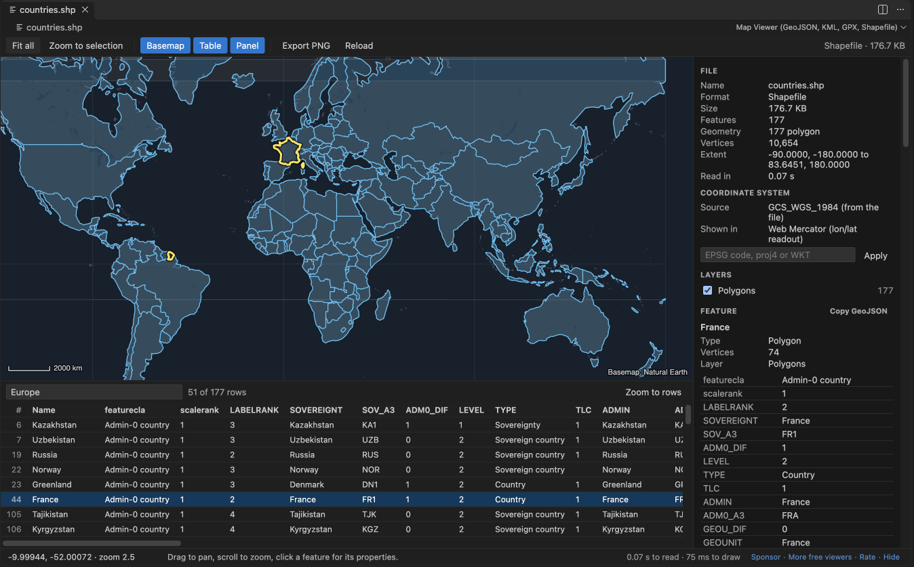
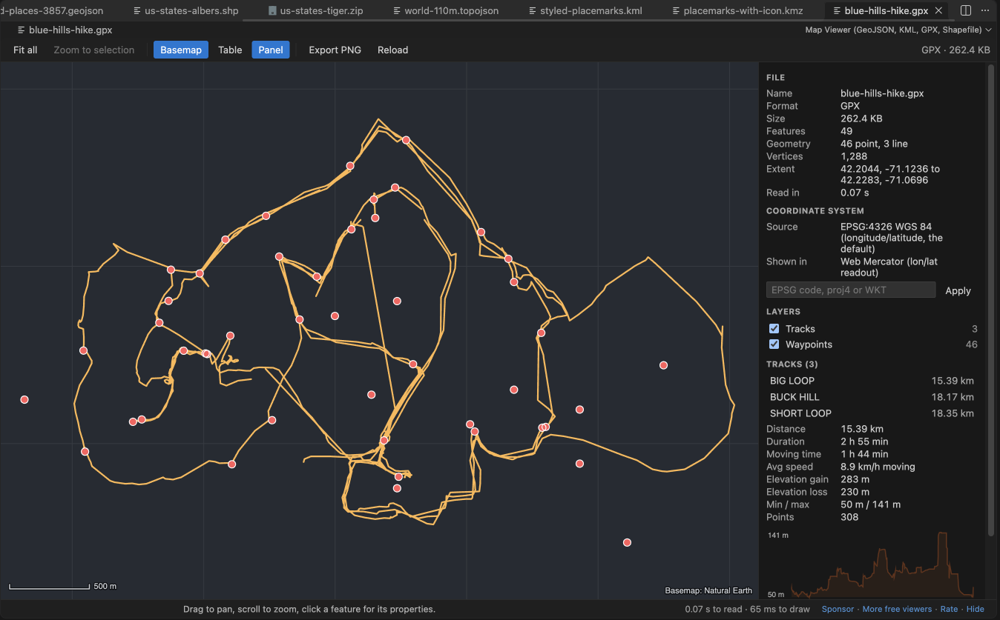
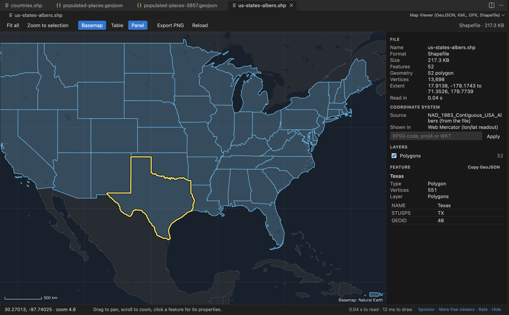
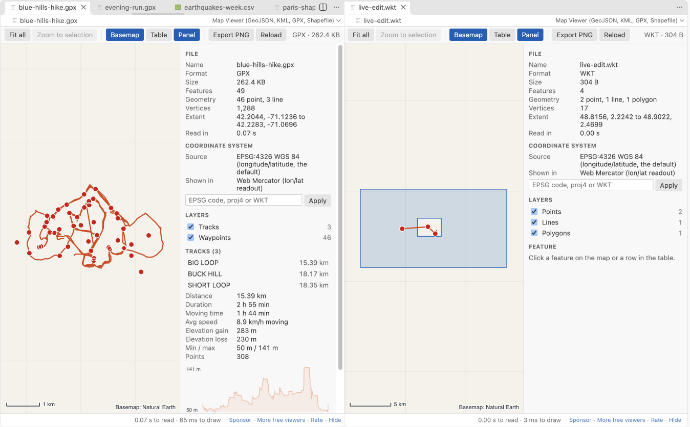

# GeoJSON Viewer, KML Viewer & GPX Viewer for VS Code

See GeoJSON, KML, KMZ, GPX, shapefiles, TopoJSON, WKT and CSV files on a map inside VS Code. Free, no sign-in, works offline: the basemap ships with the extension and nothing is fetched from the internet.

- Click a feature to see its properties. Open the attribute table, filter it, click a row to zoom there.
- GPX tracks show distance, duration, moving time, elevation gain and an elevation profile.
- Shapefiles are reprojected from their `.prj` file (UTM, State Plane, Lambert, Albers and more).
- 100 MB files open in a few seconds. Parsing and drawing run in a background worker, so VS Code stays responsive.
- Works in Remote SSH, WSL, Dev Containers and Codespaces: files are read through VS Code, not from a local path.
- Export the current view as a PNG image. Dark and light themes follow VS Code.

## Open a file

- `.gpx`, `.kmz`, `.shp` and `.topojson` open on the map when you click them.
- `.geojson`, `.kml` and `.wkt` open as text, because people edit them. Click the map button in the editor title bar to open the map beside the text. The map redraws while you type.
- Right-click any supported file in the Explorer and pick Open in Map Viewer. This also works for `.json` (GeoJSON or TopoJSON), `.csv` and `.tsv` with latitude and longitude columns, and `.zip` files that hold a shapefile.
- To always open GeoJSON on the map, add `"workbench.editorAssociations": { "*.geojson": "geoMapViewer.mapOption" }` to your settings.

## What you get

| | |
|---|---|
| Map | Offline basemap (Natural Earth 1:50m countries and lakes), graticule, scale bar, drag to pan, scroll to zoom, latitude and longitude under the cursor (click to copy) |
| Features | Click for properties, outline of the selection, Copy GeoJSON of one feature, Fit all, Zoom to selection |
| Table | Every feature with its attributes, a filter box that searches all values, Zoom to rows, click a row to zoom to it |
| Layers | KML folders, TopoJSON objects, GPX tracks and waypoints, or geometry types; tick boxes to hide or show |
| Styles | SimpleStyle properties (`stroke`, `stroke-width`, `fill`, `fill-opacity`, `marker-color`, `marker-size`) and KML styles |
| GPX | Distance, duration, moving time (above 1 km/h), average moving speed, elevation gain and loss, lowest and highest point, elevation profile, waypoint names |
| Coordinate systems | `.prj` files, the GeoJSON `crs` member (for example EPSG:3857), EPSG codes typed in the panel (UTM zones, British National Grid, Lambert-93, RD New, LAEA Europe, Conus Albers, NZTM, LV95 and others), or any proj4 string or WKT. Raw Web Mercator numbers without a `crs` are detected. |
| Export | PNG of the current view through a save dialog |

GPX numbers were checked against gpxpy 1.6.2 on a 3-track hike: distance within 0.11%, duration and moving time equal.

## Formats

| Format | Extensions | Notes |
|---|---|---|
| GeoJSON | `.geojson`, `.geo.json`, `.json` | FeatureCollection, Feature, bare geometries, newline-delimited GeoJSON, NaN values read as empty |
| TopoJSON | `.topojson`, `.json` | One layer per object |
| KML and KMZ | `.kml`, `.kmz` | Folders, styles, MultiGeometry, gx:Track, ground overlay outlines |
| GPX | `.gpx` | Tracks, routes, waypoints |
| Shapefile | `.shp` with `.dbf`, `.prj`, `.cpg` next to it; `.zip` | Points, lines, polygons with holes, Z and M values, attribute encodings from `.cpg` |
| WKT | `.wkt` | One geometry per line, EWKT `SRID=...;` prefix |
| CSV and TSV | `.csv`, `.tsv` | Columns named lat/lon, latitude/longitude, y/x and similar, or a WKT column |

## Large files

The file is parsed and packed into typed arrays in a web worker, and the map is drawn on an offscreen canvas. Features smaller than a pixel are drawn as dots and vertices closer than a pixel are skipped, so drawing time follows the screen, not the file. In a test in VS Code 1.142, a 123 MB GeoJSON with 200,000 polygons and 4.1 million vertices showed on the map about 3 seconds after the click (2.9 and 3.1 s in two runs). The editor stayed usable while it loaded: its longest pause was 0.1 to 0.24 s.

Files above 512 MB show a message and are not read. Change the limit with `geoMapViewer.maxFileMB`.

## Privacy and safety

- No network: the webview content security policy allows no remote address, and the basemap is a file inside the extension.
- KML NetworkLinks, remote icons and overlay images are never loaded. The panel tells you how many there were.
- XML entity declarations are removed before a KML or GPX is read, so an entity bomb cannot expand.
- KMZ and ZIP files are unpacked with a size and ratio guard. A zip bomb stops with a message after a fraction of a second.
- Broken coordinates (NaN, latitude beyond 90, text) are left out and counted. The rest of the file still draws.
- No telemetry, no account, no ads.

## Settings

| Setting | Default | |
|---|---|---|
| `geoMapViewer.maxFileMB` | 512 | Largest file to open |
| `geoMapViewer.basemap` | true | Show the offline basemap |
| `geoMapViewer.livePreview` | true | Redraw while you edit the text (files up to 20 MB) |
| `geoMapViewer.askForRating` | true | Ask once or twice for a Marketplace rating, after a few files on different days |
| `geoMapViewer.showSupportLinks` | true | Small Sponsor and More free viewers links in the status line |

## Keyboard

Arrow keys pan, `+` and `-` zoom, `0` fits all features, `F` zooms to the selection, `B` toggles the basemap, `T` the table, `P` the panel, `Esc` clears the selection.

## Support Zovo

Zovo extensions are free, with no ads and no tracking. They are made by [theluckystrike](https://github.com/theluckystrike) on GitHub. If this one saves you time, you can support the work:

- [Sponsor on GitHub](https://github.com/sponsors/theluckystrike)
- [Follow theluckystrike on GitHub](https://github.com/theluckystrike)

## More tools by Zovo

- [JSONL Viewer, Large JSONL Table & NDJSON Viewer](https://marketplace.visualstudio.com/items?itemName=zovo.zovo-jsonl-viewer) opens JSONL and NDJSON files as a table, as records or as a chat view.
- [XLSX Viewer, Excel Viewer, CSV Viewer & Parquet Viewer](https://marketplace.visualstudio.com/items?itemName=zovo.table-viewer-vscode) opens CSV, TSV, Excel and Parquet files as a sortable, filterable table.
- [Large JSON Viewer, JSON Browser & JSON Tree](https://marketplace.visualstudio.com/items?itemName=zovo.zovo-json-tree-viewer) shows large JSON files as a searchable tree, copies JSONPath and turns arrays of objects into a table.
- [SQLite DB Viewer & SQLite Viewer, Database Viewer (Read-Only)](https://marketplace.visualstudio.com/items?itemName=zovo.sqlite-table-viewer) browses SQLite tables read-only and runs SELECT queries.
- [NetCDF Viewer & HDF5 Viewer (NC Viewer, H5 Viewer)](https://marketplace.visualstudio.com/items?itemName=zovo.hdf5-netcdf-explorer) browses groups, attributes and values in HDF5 and NetCDF files and plots slices.

See [all Zovo extensions on the Marketplace](https://marketplace.visualstudio.com/publishers/zovo).

## License

MIT. Bundled libraries and the basemap data are listed in [THIRD-PARTY-NOTICES.md](THIRD-PARTY-NOTICES.md).
